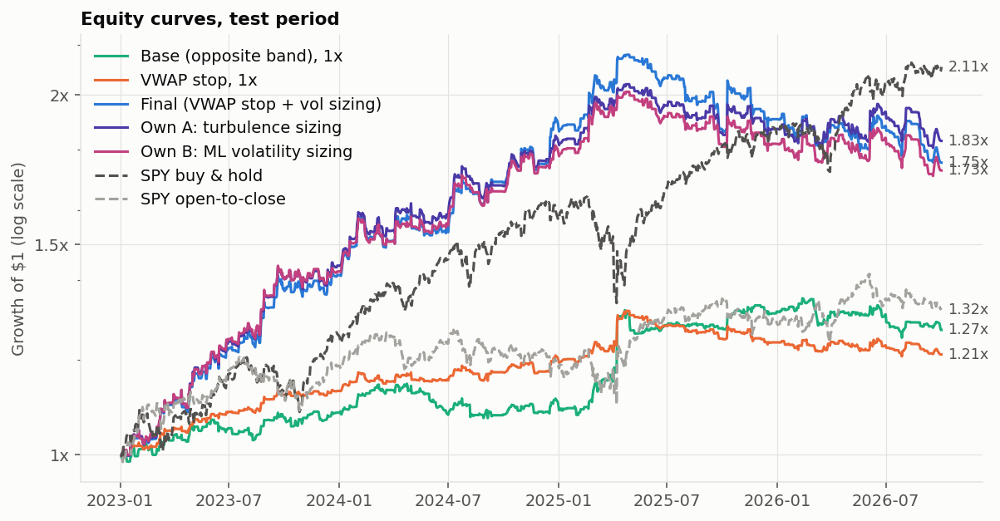

# Intraday Momentum on SPY with Volatility-Forecast Sizing

An intraday breakout strategy on SPY 1-minute bars (January 2016 – October 2026) where every trade is
sized at entry by a forecast of how volatile the rest of the day will be.

**Why sizing, not signal filtering.** Whether a breakout wins is not predictable at entry: classifiers
on entry features score AUC 0.46–0.54. Rest-of-day volatility is: realized volatility from the open
to the decision has a Spearman correlation of 0.71 with realized volatility from the decision to the
close. Daily volatility targeting fixes leverage at the open, so it takes the largest risk on the
most turbulent days. The most turbulent fifth of trades carried 41% of the risk and earned 7% of the
P&L.

Code structure, file by file: [`SKELETON.md`](SKELETON.md).

## Results

Test period 2023-01-03 – 2026-10-02, net of $0.0035 commission + $0.001 slippage per share on every
fill, $100,000 starting capital.

| | Annual return | Volatility | Sharpe | Max drawdown | Beta |
|:--|--:|--:|--:|--:|--:|
| Baseline (daily vol target) | 16.3% | 14.4% | 1.12 | 18.8% | −0.03 |
| **A: turbulence sizing** | **17.6%** | **12.5%** | **1.35** | **11.5%** | −0.01 |
| B: ML volatility sizing | 15.8% | 12.6% | 1.22 | 15.0% | −0.01 |
| SPY buy & hold | 22.1% | 14.9% | 1.42 | 18.8% | 1.00 |

On the 2016–2022 train period, A moved the Sharpe from 1.07 to 1.30 and the max drawdown from 24.7%
to 20.8%.



## Signal

For each minute of the day, σ is the mean absolute move from the open at that minute over the
previous 14 days. Bands:

```
upper = max(open, prev_close) × (1 + σ)
lower = min(open, prev_close) × (1 − σ)
```

Checked every 30 minutes from 10:00 to 15:30: long above `upper`, short below `lower`. Trailing stop
at the band or VWAP, whichever is tighter. Flat at the close.

## Sizing

```
L    = min(4, 0.02 / σ_daily_14d)             # daily leverage, set at the open
m    = clip(1 / v̂, 0.5, 1.5)                  # per-trade multiplier, set at entry
size = floor(AUM × L × m / open)              # total leverage capped at 4×
```

`v̂` is the expected rest-of-day volatility relative to normal. `m` is fixed at entry and held to exit;
the trade set is identical to the baseline, only size changes.

**A — turbulence (`own_turbulence`).** No fitted parameters:

```
v̂_t = sqrt( Σ r²[open → t]  /  mean over prior 14 valid days of Σ r²[open → t] )
```

with `r` the 1-minute log returns and the normal taken at the same minute `t`.

**B — ML forecast (`own_ml_vol`).** `HistGradientBoostingRegressor` predicting
`log(RV[fill → close] / normal)`, with `v̂ = exp(prediction)`.

- Features: realized vol so far vs normal, realized vol of the last 30 minutes vs normal, volume so
  far vs normal, VIX vs 14-day realized vol.
- Depth 1, 250 iterations, learning rate 0.05, min leaf 200, L2 10, monotone constraints
  ([`config/ml_sizing.yaml`](config/ml_sizing.yaml)).
- Trained once on 2016–2022 using every decision time of every day (~21,000 rows, not only the
  ~1,500 trades), then frozen. It never sees direction or P&L.

## Validation

- **Walk-forward, 2018–2022, four blocks.** Sharpe vs baseline: A +0.28 [+0.06, +0.49],
  B +0.24 [+0.04, +0.44].
- **Single test run.** Both versions frozen in git, then run once on 2023–2026, scored with a paired
  block bootstrap. A: +0.23 [−0.01, +0.44], most of it in 2026. B: +0.10, and significantly worse
  than A (−0.13 [−0.24, −0.02]).
- **Fixed rules.** Split dates, costs and success criteria are set in
  [`config/research.yaml`](config/research.yaml) before any backtest. Every run is logged in
  `results/experiment_log.csv` for the Deflated Sharpe ratio.
- **Look-ahead tests.** Perturbing future data must leave past outputs unchanged; the ML model is
  checked to see no test-period rows.

All versions tried and why each was kept or dropped: [`docs/own_strategy_attempts.md`](docs/own_strategy_attempts.md).

## How to run

Market data (~1.4 GB) is not included. Download it with a free [Alpaca](https://alpaca.markets)
account: put the API key and secret in `.env` in the project root, in the format at the top of
[`requirements.txt`](requirements.txt).

```bash
pip install -r requirements.txt
python -m scripts.01_download_data --symbols SPY      # minute bars, daily bars, dividends, VIX, calendar
python -m scripts.02_build_dataset --symbols SPY      # clean tables + features
python -m scripts.03_run_backtests                    # baseline backtests, train period
python -m scripts.04_checkpoint                       # diagnostics, train period
python -m scripts.05_own_strategy                     # sizing versions vs baseline, train period
python -m scripts.06_run_test                         # test period
python -m scripts.07_robustness                       # variants and cost models
python -m pytest
```

Reports go to `results/`, figures to `results/figures/`. Tests that need real data skip if it has
not been built.

Base signal: Zarattini, Aziz & Barbon, *Beat the Market: An Effective Intraday Momentum Strategy for
S&P500 ETF (SPY)*, SSRN.
